# Nutrition Scribe

**A food log you talk to.** Say, type or scan what you ate, in the words you'd actually
use, and it works out the nutrition.

> "2 eggs and toast" · "half a cup of cottage cheese" · "my usual lunch but two burritos"

Android phone app with a Wear OS watch app. Free and open source: no ads, no account,
no subscription. Your log stays on your phone, and **nothing you eat leaves it unless
you turn on AI with your own key** (see [What leaves your phone](#what-leaves-your-phone)).

<p align="center">
  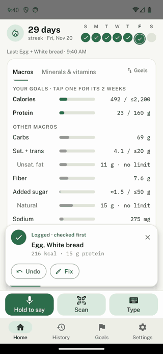
  &nbsp;
  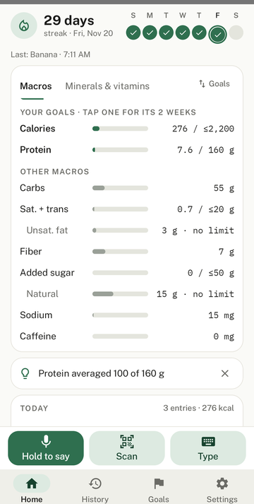
  &nbsp;
  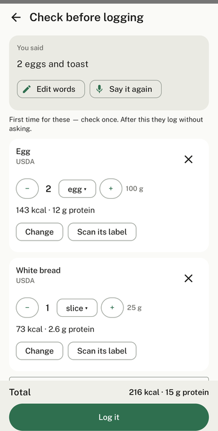
</p>
<p align="center">
  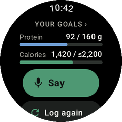
  &nbsp;
  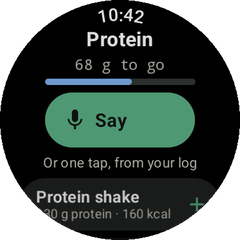
  &nbsp;
  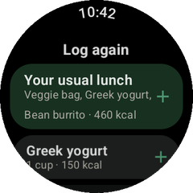
</p>

<sub>All screenshots use made-up sample data.</sub>

## Get it

The app is in beta. Each version's signed APKs are on the
[**Releases**](../../releases) page.

1. **Phone:** open the release on your phone and download `NutritionScribe-<version>.apk`.
   Tap it, allow installs from that source when asked, then tap **Install**.
2. **Watch (optional):** `NutritionScribe-Watch-<version>.apk` is for a Wear OS 3+ watch
   (built on a Galaxy Watch 7). Install it with `adb` (see [Sideloading](#sideloading)).
3. Open the phone app. It asks your first name, what to track, and whether you have an
   AI key. Without a key it still works, offline, from its built-in food list.

Already have an earlier version? Install over it and your log is kept.

**Updates come to you.** From 1.10 the phone app looks at this repo's releases when you open
it (twice a day at most). A newer version shows a card on Home: tap **Update**, and the app
downloads it from GitHub, checks it's signed with the same key, and hands it to Android to
install. Android asks once to allow installs from Nutrition Scribe, and on the first update
asks "Update this app?"; after that, Android 12+ can update it without the extra box. Your log
stays. Settings › Updates has **Check for updates** and a switch to stop it looking by itself.
The watch app still installs with `adb`.

## What it does

**Logging**
- **Say it, type it or scan it.** Hold Say and talk; pauses don't cut you off. A
  barcode, the front of a pack or the Nutrition Facts panel is read on the phone.
- **Check once, then it's yours.** The first time you log a food you see what it was
  taken to be and fix anything. After that it goes straight in.
- **Fix it in words.** On a logged entry: "it was two bowls", "that was the low-sodium
  bacon". With an AI key, "Fix it" works out what you meant, and you can undo it.
- **Log again.** Your most-logged foods are one tap away, and so are **your usual meals**:
  the same few foods you log together on different days become one tap
  ("Your usual lunch: veggie bag, Greek yogurt, burrito").
- **Say a barcode.** "Barcode 0 78742 05731 6" finds the product. The last digit is a
  check digit, so a misheard number asks you to scan instead of logging the wrong thing.
- **Store foods.** Optional packs of real labels for the stores you shop at
  (from Open Food Facts), downloaded in Settings.

**Goals and what you need**
- Calories, protein, carbs, fat, fibre, sugar (natural and added), saturated fat,
  sodium, caffeine, cholesterol, and minerals and vitamins. Extras (omega-3, B vitamins,
  copper, choline, alcohol and more) are off by default and marked ≈.
- Targets from the DRI tables and your height, weight, age and activity, or your own
  numbers. Tap a goal for its last two weeks, with your average and the goal line.
- **Plasma donors:** a donation's protein is added back over that day and the next.

**Looking back**
- **History:** each nutrient's daily average over the last week, two weeks, month or
  three months, against the same stretch before it (▲ 4%), and every entry, searchable.
- **Over time:** a chart you can pinch and drag, with your average, your goal, and the
  foods that gave you the most of it.
- **Ideas and Ask:** foods that would close a gap, from what you already eat, and a chat
  for questions (Ask needs an AI key).
- A logging streak (the day ends at 3 AM; rest days don't break it), AI spending per
  entry and per month, and export and import as JSON or CSV.

<p align="center">
  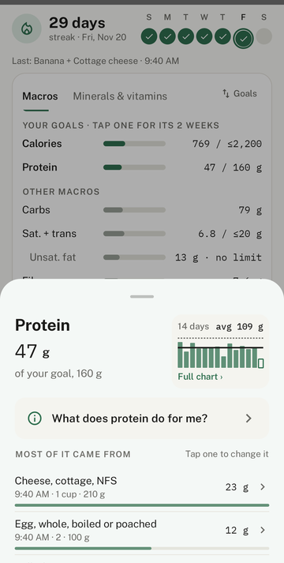
  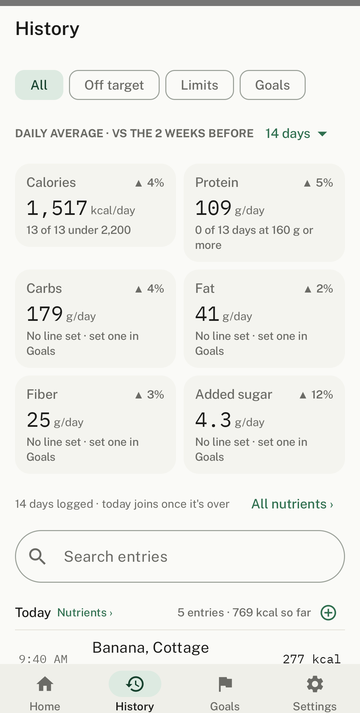
  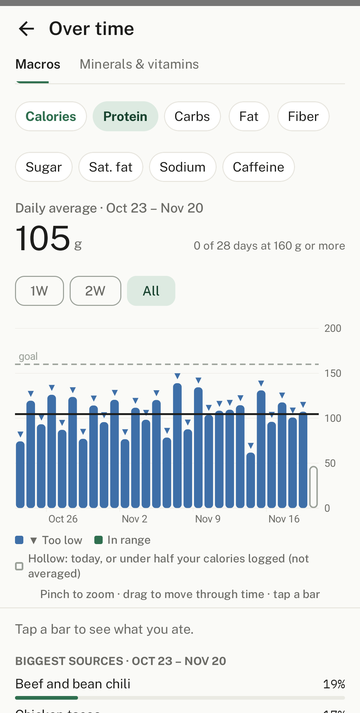
  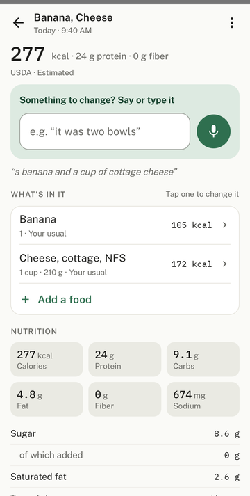
</p>
<p align="center">
  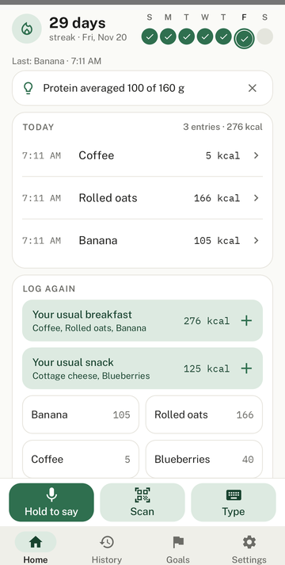
  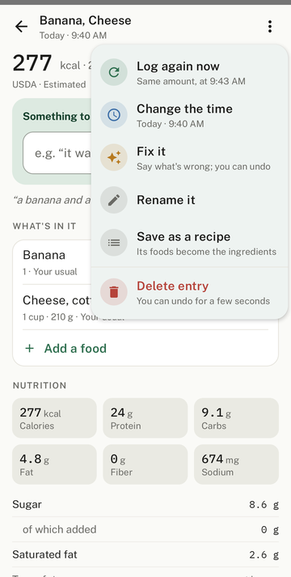
  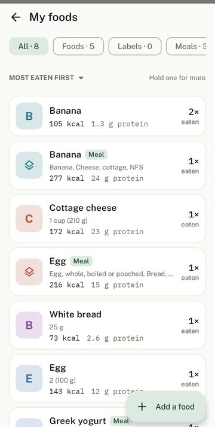
  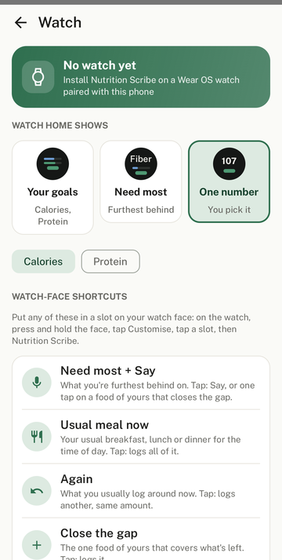
</p>

## On your watch

The watch app is for logging without getting your phone out. It never works foods out
itself: it sends your words to the phone and shows what the phone found.

- **Say**, check the foods and calories, and **Log it**. You land back on the watch home
  with Logged · Undo for 5 seconds. Say "barcode" and its numbers for a package.
- **Log again** with your usual meals at the top.
- **The watch home** shows your goals, whatever you're furthest behind on, or one number.
  You pick in the phone's Settings › Watch.
- **Watch-face shortcuts.** Put any of these in a slot on your watch face (press and
  hold the face › Customise › tap a slot › Nutrition Scribe):

  | Shortcut | Shows | Tap it to |
  |---|---|---|
  | Need most + Say | what you're furthest behind on, "21 g Fiber" | say what you ate, or log one of your own foods that closes the gap |
  | Usual meal now | your usual breakfast, lunch or dinner for the time of day | log all of it |
  | Again | what you usually log around now | log another, same amount |
  | Close the gap | the one food of yours that covers what's left, "+30 g" | log it |
  | Since you logged | time since your last entry | say what you ate |
  | Waiting on phone | entries the watch couldn't finish (only while there are some) | see where to check them |
  | Your main goal · Say | grams to go, or a mic | open the app, or start listening |

  Every one-tap log can be undone for 5 seconds.
- **A tile** with your main goal and a Say button.
- **When the watch can't manage**, nothing is lost. A long order goes to the phone's
  *From your watch* list, where AI can split it into foods for you to check. Anything
  said while the phone is out of reach waits on the watch and is logged at the time you
  said it.

The phone↔watch link is built and tested piece by piece, but it hasn't yet been run on
a real paired phone and watch (see [Known limitations](#known-limitations)).

## How a food is looked up

Four layers, tried in order (`shared/.../resolve/Resolver.kt`):

1. **Your own confirmed foods** and usual meals. A hit logs without asking.
2. **The built-in data**: about 13,400 USDA foods (SR Legacy and FNDDS) with real
   household portions, plus a label pack of about 230,000 packaged products (USDA
   Branded Foods) and any store packs you've added. Lookups take about 50 ms, offline.
3. **Help when those are weak:** scan the package, say its barcode, or break a homemade
   dish into its ingredients. A barcode not in the packs is looked up in Open Food Facts.
4. **AI, with your own key**, for brands, restaurant meals and whole rambling sentences:
   OpenAI (GPT-6 Luna by default) or Anthropic (Claude Haiku 5.5 by default), chosen per
   job under Advanced › AI models.

AI needs a developer API key from [OpenAI](https://platform.openai.com/api-keys) or
[Anthropic](https://console.anthropic.com/settings/keys). A ChatGPT Plus or Claude Pro
subscription doesn't include one. The key is stored encrypted on the phone and is never
bundled, committed or logged. A typical lookup costs a fraction of a cent, and the app
shows what you've spent.

### How accurate is it?

- **With AI on:** on a benchmark of 300 real, everyday entries, scored against the
  numbers on their package labels, the median calorie error was **6.8%**, and **79%** of
  entries were within 20% (October 2026, `BenchRunTest` and `tools/bench_score.py`).
- **Offline:** plain foods are fine ("2 eggs" gives 143 kcal, against 144 from AI). It
  struggles with restaurant meals and brands not in the label pack, with dishes where
  one part gets lost ("falafel wrap" logs the falafel), and with portions that aren't
  USDA's. That's what scanning, store packs and AI are for.
- **Photos of a plate** aren't used for logging. In a 2026 independent test of four
  photo-logging apps, all of them came in 250–345 kcal under per meal; saying what you
  ate, and how much, does much better.

## What leaves your phone

| When | What is sent | Where |
|---|---|---|
| AI lookups on (your key) | The words of the entry | The provider you picked |
| Speech to text set to OpenAI (Settings › Microphone) | The recording of a spoken entry | OpenAI transcription |
| Ask | Your question and the foods and targets it needs (with Search the web on, OpenAI may search for it) | The provider you picked |
| An entry's "Fix it" | What you said is wrong, and that entry's foods and numbers | The provider you picked |
| "Work it out with AI" on something from your watch | The words you said on the watch | The provider you picked |
| A barcode the packs don't have | The barcode number only | Open Food Facts |
| Settings › Store foods › Get | Nothing about you: a plain download of that store's pack | GitHub (this repo's `store-packs` release) |
| Opening the app (Check by itself on), or Check for updates | Nothing about you: a plain read of the release list, then the APK if you tap Update | GitHub (this repo's releases) |
| Using the watch app | Your words and the results, between your watch and your phone only | Your own phone, over Wear OS |

Without a key, only the last four happen. Before an AI provider is used for the first
time, the app shows what it sends and what that provider's data policy says. Speech goes
through Android's own recognizer, on the phone, unless you choose OpenAI.

## Beta builds

Versions whose name contains `test` (now `1.10-test`) are for testers:

- **First open:** your first name, the test week in three lines, a practice
  shake-to-report, what leaves the phone, and the key step (with a "no key" path).
- **Shake the phone** when something looks wrong to save a note with a screenshot (on
  by default; Settings › Beta testing turns it off). Notes stay on the phone until you
  send your log.
- **Day 7:** three questions, then "What's in your log": what always goes, and the
  personal parts (body stats, plasma days, label photos), each free to untick. The API
  key is never in it.

How a round runs: [`docs/BETA_TESTING.md`](./docs/BETA_TESTING.md). How a release is
made: build and sign both APKs, commit them to `releases/` with
`releases/NOTES-<version>.md`, and push; `.github/workflows/release.yml` publishes the
release once. Phones on 1.10 or later find it there and offer it on Home. A version whose
watch app didn't change can leave the watch APK out: the release attaches the newest one committed.

## Build

Gradle multi-module project (`app`, `wear`, `shared`) with the wrapper checked in.

- JDK 17 (Temurin 17.0.20.1+1)
- Gradle 8.11.1, AGP 8.9.2, Kotlin 2.0.21
- Android SDK Platform 36 (and 34 for the watch), Build-Tools 36
- Phone: Android 8.0 (API 26) and up. Watch: Wear OS 3 (API 30) and up.

Setting up a new machine, including the files deliberately not in this repo (signing
key, label pack): [`docs/SETUP.md`](./docs/SETUP.md).

```
./gradlew -Dorg.gradle.jvmargs=-Xmx2g :app:assembleDebug :wear:assembleDebug
./gradlew -Dorg.gradle.jvmargs=-Xmx2g :app:assembleRelease :wear:assembleRelease
```

Release builds are signed when `keystore.properties` exists, and unsigned otherwise.
Without `app/src/main/assets-pack/` the build still works; it just ships no label pack.

UI work follows [`docs/UI_GUIDELINES.md`](./docs/UI_GUIDELINES.md). The full design
spec is [`nutrition-scribe-blueprint.md`](./nutrition-scribe-blueprint.md).

## Tests

```
./gradlew :shared:testDebugUnitTest :app:testDebugUnitTest   # JVM, seconds
./gradlew :app:connectedDebugAndroidTest                     # emulator; wipes the app's data
```

Every bug fix comes with a test that fails without it. What can't be tested
automatically (the phone↔watch link, camera, speech) is listed in
[`docs/MANUAL_CHECKS.md`](./docs/MANUAL_CHECKS.md). The instrumented tests matter:
Android's SQLite ships without `fts5`, so search uses a hand-built word index, and that
difference only shows up on a device.

## Sideloading

```
adb install -r NutritionScribe-1.10-test.apk
```

`-r` installs over the existing app and keeps its data. Updates must be signed with the
same key, so never uninstall to update.

**Watch:** on the watch, turn on Developer options › Wireless debugging and pair it, then
`adb connect <watch-ip>:<port>` and `adb -s <watch-ip>:<port> install -r NutritionScribe-Watch-1.9-test.apk`.
The phone and watch apps share the package name `com.nutritionscribe` and signing key,
which is how they find each other.

## The data and the tools

The food list is built from USDA FoodData Central (public domain):

```
python3 tools/build_food_db.py <dir-with-unzipped-FDC-csvs> -o food.db
python3 tools/curate_food_db.py food.db
python3 tools/add_extras_food_db.py <same-dir> food.db   # the extra nutrients
cp food.db app/src/main/assets/food.db
```

Then **bump `assetVersion` in `FoodDatabase.kt`**, or installed copies keep the old
data (and `MicroBackfill.VERSION` when foods gain nutrients). The label pack comes from
`tools/build_label_pack.py`; store packs from `tools/build_store_pack.py` (Open Food
Facts, ODbL, credited in the app).

`tools/foodsearch.py` is the Python reference for `FoodQuery.kt`, and
`FoodQueryParityTest` keeps them in step: when they drifted once, the stemmer turned
"pancakes" into "pancak" and no search for "pancake" could find it, with no error
anywhere.

| tool | what it measures |
|---|---|
| `bench_food_db.py` | ranking and sense on curated phrases, plus speed |
| `bench_real_log.py` | an exported log against the AI answers stored in it |
| `bench_friends.py` | harder input from people other than the author |
| `compare_ai_offline.py` | head-to-head against a live API (needs a key) |
| `BenchRunTest` + `bench_pairs.py` + `bench_score.py` | entries through the real lookup and AI, scored against package labels |

Exported logs are personal data. They're gitignored, and the tools only read them.

## Data and backup

Everything lives in a local database on the phone (`protein-scribe.db`, under its
pre-rename name so existing logs aren't stranded). The watch keeps a small cache and a
queue of anything it couldn't hand over yet. There's no cloud, no sync and no account,
so use **Settings › Export** before you uninstall anything.

## Known limitations

- **The phone↔watch link hasn't been run on real paired devices yet.** Each side is
  tested (the messages both ways, the phone's listener, the watch screens and shortcuts
  on the Wear OS emulator), but not the two together.
- Watch-face shortcuts are drawn by the watch face, so they look a little different on
  each face. The emulator's faces have no slots, so only the picker entries and taps are
  tested.
- English only. Edge-to-edge layout is unverified on Android 15 and up.
- R8 is off, so the APKs are large (about 50 MB each).

## License

MIT, see [`LICENSE`](./LICENSE). Food data: USDA FoodData Central (public domain) and
Open Food Facts (ODbL).
